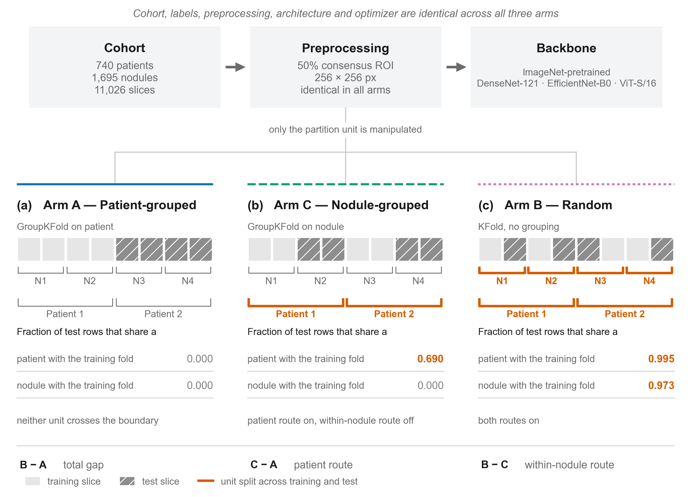

# Data-partition leakage in pulmonary nodule classification

Code, cross-validation partition indices and retained per-sample predictions for a controlled
experiment on **LIDC-IDRI**: how much does the *unit* at which data are partitioned inflate reported
performance, and **which** route produces the inflation?

Deep-learning studies on this benchmark have reported accuracies above 95% and AUCs above 0.98.
Many partition below the patient, or do not say how they partition, so observations from one patient
can appear in both training and test folds. Rather than compare against heterogeneous published
numbers, this study **tests the question by design**: one cohort, identical labels, preprocessing,
architecture and training, varying only the partition unit.

> Published in *IEEE Access*, doi:[10.1109/ACCESS.2026.3750625](https://doi.org/10.1109/ACCESS.2026.3750625)
> (Early Access). `CITATION.cff` carries the citation metadata.

## The design

Three arms differing **only** in how folds are formed, over 3 repeats × 5 folds = 15 matched folds:

| arm | grouping | within-nodule route | patient route | measured L(patient) |
|---|---|---|---|---|
| **A** `patient` | by patient | off | off | 0.000 |
| **B** `random` | none | **on** | **on** | 0.995 |
| **C** `nodule` | by nodule | off | **on** | 0.690 |

A and B alone establish *that* the partition unit matters but cannot say *which* route does it — a
random split opens both at once. Arm C closes the within-nodule route while leaving the patient route
active **at nearly full sample density**, which separates them.



Every number in that figure is read from the released artifacts when it is drawn, and exported
alongside it as `schematic_values.csv`; the render fails rather than fall back to a literal.

The partition unit is the only thing the design manipulates, but forming folds differently also
changes what each model is trained and selected on. The quantity estimated is therefore the total
effect of the partitioning protocol on training, model selection and evaluation, which is the
effect a study inherits when it chooses a partition unit.

## What was found

**Random partitioning inflated reported performance in every fold.** At the prespecified primary
(slice) level, it raised AUC by **+0.064** for DenseNet-121 (95% CI +0.031 to +0.097), **+0.082** for
EfficientNet-B0 (+0.056 to +0.108) and **+0.074** for ViT-S/16 (+0.036 to +0.112), also when the two
arms are re-scored on identical test rows. Calibration degraded in parallel (log-loss +0.176, +0.315
and +0.221). At the nodule level the gap was +0.060 to +0.072 with one prediction per nodule.

The three-arm decomposition localises it. Under the assumption that the two routes do not interact,
**no contribution from the patient route was detected** in any of the three architectures, including
the transformer (the intervals reach +0.059 in AUC), while the within-nodule contrast corresponds to
most of the gap in log-loss and Brier (point estimates 84–98%). Grouping folds by nodule therefore
removed all the inflation this design could detect, without excluding a smaller patient-level
contribution. The null is measured at nearly full sample density: arm C trains on 12.4 slices per
patient, against 14.9 in arm A.

The practical consequence is a narrower and firmer recommendation than the usual advice: **no study
should partition below the nodule**, every study should state its partition unit, and every study
should release executable partition indices so the choice can be audited rather than trusted. These
magnitudes were measured in LIDC-IDRI only.

## Requirements

```
conda env create -f environment.yml    # or: pip install -r requirements.txt
conda activate nodules
```
Python 3.10, PyTorch 2.3.1+cu121. Trained on a single 8 GB GPU (RTX 4060 Ti) using mixed precision
and gradient accumulation.

## Data

LIDC-IDRI is obtained from TCIA — it is **not** redistributed here. See `data/README.md` for the
download and for the `pylidc.conf` pointing at the DICOM root. Preprocessing produces ~8 GB of
arrays and model weights ~6 GB; neither is committed, both are regenerable from the committed code
and indices.

## Reproducing the paper

Every number in the manuscript is regenerated from committed artifacts **without a GPU**: the analysis
reads only the split files, the per-sample predictions, the run histories and the cohort tables in
this repository, wherever it is cloned (paths are resolved from the repository itself, not from
`config.yaml`). Retraining is only needed to reproduce the artifacts themselves.

```
# --- analysis only, from what is already committed (minutes, no GPU), from the repository root ---
python scripts/verify_grid_consistency.py          # gate: is the grid one experiment, the declared one?
python scripts/verify_leakage.py                   # gate: partition rules, on the committed indices
python scripts/cohort_summary.py                   # Table I and the label clustering (ICC)
python scripts/audit_controls.py                   # slice-level gap + matched-rows control
python scripts/fold_tests.py                       # Nadeau-Bengio intervals and paired tests
python scripts/nodule_oof.py                       # nodule level, one prediction per nodule per repeat
python scripts/decompose_routes.py                 # the three-arm route decomposition
python scripts/nodule_unit_gap.py                  # the gap with the nodule as the sample unit
python scripts/standardised_gap.py                 # the gap in fold-SD units
python scripts/project_stratification.py           # stratified vs grouped folds
python scripts/project_balancer.py                 # a near-perfect fold balancer
python -m src.evaluate                             # per-model tables
python -m src.figures --sample-units slice,nodule  # curves + confusion matrices
python figures/schematic.py                        # Fig. 1, drawn from the indices
python scripts/literature_survey_counts.py         # the literature-search counts of Related Work
python scripts/check_artifact_freshness.py         # gate: is any result absent, or older than its inputs?
```

Every script defaults to the reported grid (3 repeats x 5 folds, every arm, the three architectures)
and writes the file the paper cites. A narrower call (fewer repeats, folds, arms or architectures)
writes under a suffixed name, or not at all, and never over a canonical result.

```
# --- full rebuild, from raw DICOM (days, GPU) ----------------------------------------
python scripts/verify_download.py                                # data completeness
python -m src.metadata                                           # cohort tables
python -m src.preprocess                                         # ROI extraction -> .npy
python -m src.splits --arm patient --repeats 3 --folds 5         # and --arm random / --arm nodule
python scripts/relativise_paths.py                               # path column relative to the repository
powershell -File scripts/run_grid.ps1 -Phase grid -Reps "0,1,2" -Arms "patient,random,nodule" -SampleUnits "slice,nodule"
```

`run_grid.ps1` is resumable and idempotent: it skips runs whose artifacts are already **content-valid**
(weights load, probabilities finite and length-matched to the test split), never by mere file
existence.

### Which script produces which result

| Manuscript item | Produced by | Reads |
|---|---|---|
| Table I — cohort and acquisition | `scripts/cohort_summary.py` | `outputs/metadata/` |
| Table II — training configuration | `config.yaml`, `src/train.py`, `src/models.py` | — |
| Table III — leakage gap, both levels | `scripts/fold_tests.py` (slice level; nodule level fold by fold), `scripts/nodule_oof.py` (nodule level, one prediction per nodule) | `outputs/probs/` |
| Table IV — three-arm route decomposition | `scripts/decompose_routes.py`, `scripts/fold_tests.py` | `outputs/probs/` |
| Matched-rows control | `scripts/audit_controls.py` | `outputs/probs/` |
| Fig. 1 — design schematic | `figures/schematic.py` | `outputs/splits/`, `outputs/metadata/` |
| Fig. 2 — confusion matrices, all three architectures | `src/figures.py` | `outputs/probs/` |
| Fig. 3 — learning curves, all three architectures | `src/figures.py` | `outputs/history/` |
| Architecture comparisons within an arm | `scripts/nodule_oof.py` | `outputs/probs/` |
| Nodule as the sample unit | `scripts/nodule_unit_gap.py` | `outputs/probs/` |
| Standardised gap | `scripts/standardised_gap.py` | `outputs/probs/` |
| Stratification, balancer and label clustering | `scripts/project_stratification.py`, `scripts/project_balancer.py`, `scripts/cohort_summary.py` | `outputs/probs/`, `outputs/metadata/` |
| Leakage rates and training slices per patient | `scripts/verify_leakage.py` | `outputs/splits/` |
| Related Work — structured literature search | `scripts/literature_survey_counts.py` | `outputs/literature/` |
| Per-model tables (all metrics, fold by fold) | `src/evaluate.py` | `outputs/probs/` |

## What is committed, and why

Partition indices, per-sample predictions and per-run training histories are **in the repository**
(~11 MB), not only the aggregated numbers:

- `outputs/splits/` — the partitions themselves. See `outputs/splits/README.md` for the naming,
  the grouping unit of each arm, and the measured leakage rates. This is what lets anyone check
  the partitioning claim without running anything.
- `outputs/probs/` — `y_true` and `y_prob` for every run, so **every reported metric can be
  recomputed without retraining**, on a laptop.
- `outputs/history/` — per-epoch train/val trajectory plus the configuration hash for each run.
- `outputs/results/`, `outputs/_analysis/`, `outputs/metrics/`, `outputs/figures/` — the derived
  tables and figures, each produced by the script named above.
- `outputs/results/run_durations.csv` — wall-clock duration of each run, read from the training logs by
  `scripts/run_durations.py`; the logs are not versioned, so this table is the released record.
- `outputs/literature/` and `partition_unit_survey.md` — the literature search behind Related Work.

This exceeds usual practice for a paper repository, and it is deliberate: for a study *about*
evaluation protocol, the per-sample outputs are the evidence, not a by-product.

There are 316 archived runs: 3 architectures × 15 folds for each of the five conditions of the
principal cohort (three arms at the slice level, two at the nodule level) and the two arms of the
≥3-annotator sensitivity cohort, plus one Swin-T run (patient arm, repeat 0, fold 0) from a timing
check made before the transformer for the grid was chosen. That run enters no reported number; the
analysis scripts treat it as a probe and skip it unless it is requested by name. Each run keeps two
checkpoints' predictions: the reported one (lowest validation loss within the early-stopping
window) and, under the `_final` suffix, the last epoch, which is never used for a reported number.

**Excluded:** raw and preprocessed imaging (~8 GB) and model weights (~6 GB), both regenerable.

## Integrity machinery

The pipeline refuses to produce a result it cannot stand behind. Gates **block**, they do not warn:

- **Config–code contract** — every key in `config.yaml` must be read by code or explicitly declared
  inert, so the manuscript cannot describe behaviour the code does not implement.
- **Coverage** — training aborts unless every split row has a preprocessed image.
- **Content-validated skip** — a run counts as done only if its artifacts load and are well-formed.
- **Partition rules** — asserted when the splits are written, and re-verified on the committed
  indices by `scripts/verify_leakage.py`.
- **Grid consistency** — asserts the whole grid shares one configuration, that it **matches the
  declared config file** (not merely that runs agree with each other), and re-derives from each run's
  stored trajectory that the selected checkpoint is the one the prespecified early-stopping rule
  would select. The grid first ran with a longer patience than prespecified; the ten runs whose
  selected checkpoint would have differed were retrained (`scripts/retrain_deviating_checkpoints.ps1`).
- **Artifact freshness** — fails if any derived table or figure is older than the run outputs it is
  computed from. Added after a table was found to have been written from an analysis file that
  predated a rerun; the numbers were wrong by up to 0.0025 and nothing had warned. A timestamp
  comparison catches it in one second. It cannot see a result computed by an older version of its
  script from unchanged inputs, so producers are rerun after their code changes.

## Repository layout

```
src/          preprocessing, splits, training, evaluation, figures, statistics
scripts/      gates, analysis, and the training driver (run_grid.ps1)
config.yaml   the frozen experiment configuration; its hash is stamped into every run
outputs/      splits, per-sample predictions, histories, metrics, figures, literature search
figures/      the design schematic and the script that draws it from the indices
data/         how to obtain LIDC-IDRI; no data is redistributed
```

## A note on paths, if you clone this

`config.yaml` still points `project.root` and `lidc_dicom_root` at the machine that produced the
runs. That is deliberate rather than an oversight: `src/train.py` stamps a SHA-256 of the parsed
configuration into every run, and `scripts/verify_grid_consistency.py` fails the grid if any run's
stamp disagrees with the config file. Editing those two lines therefore changes the hash and makes
the 316 archived runs unverifiable against it.

So: to reproduce the **analysis** (the no-GPU path above), you do not need to touch it — the scripts
read the artifacts, not the raw data. To **retrain**, change those two paths and accept that your
runs carry a different configuration hash than ours, which is correct, since they are your runs.

## Citing this work

`CITATION.cff` carries the metadata, so GitHub's "Cite this repository" button generates APA and
BibTeX directly. It points at the paper rather than the code, which is what should be cited. Page
numbers are added when the final version of the article is published, rather than shipped as
placeholders that would go stale.

```
https://github.com/nykemariotto/nodule-partition-leakage
```

## Licence

MIT — see `LICENSE`. LIDC-IDRI is distributed by TCIA under its own terms.

The manuscript source is not part of this repository, which carries the code and the artifacts the
results are computed from. `partition_unit_survey.md` records, for each study surveyed in the
article's related work, the partition unit it declares and the sentence it was classified on.
